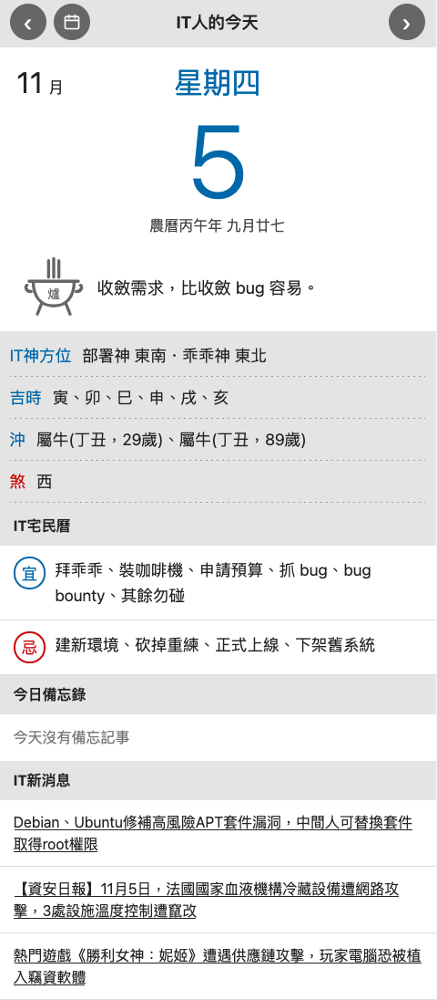

#  IT Daily (IT人的今天)

An IT-flavoured farmer's almanac. Each day's 宜/忌 come from the real lunar almanac
(via [`lunar-typescript`](https://github.com/6tail/lunar-typescript)) and are translated
into IT activities through the table in `src/yiji.ts`. When a term has several IT
equivalents, one is picked deterministically from the date, so everyone sees the same
result on the same day.

